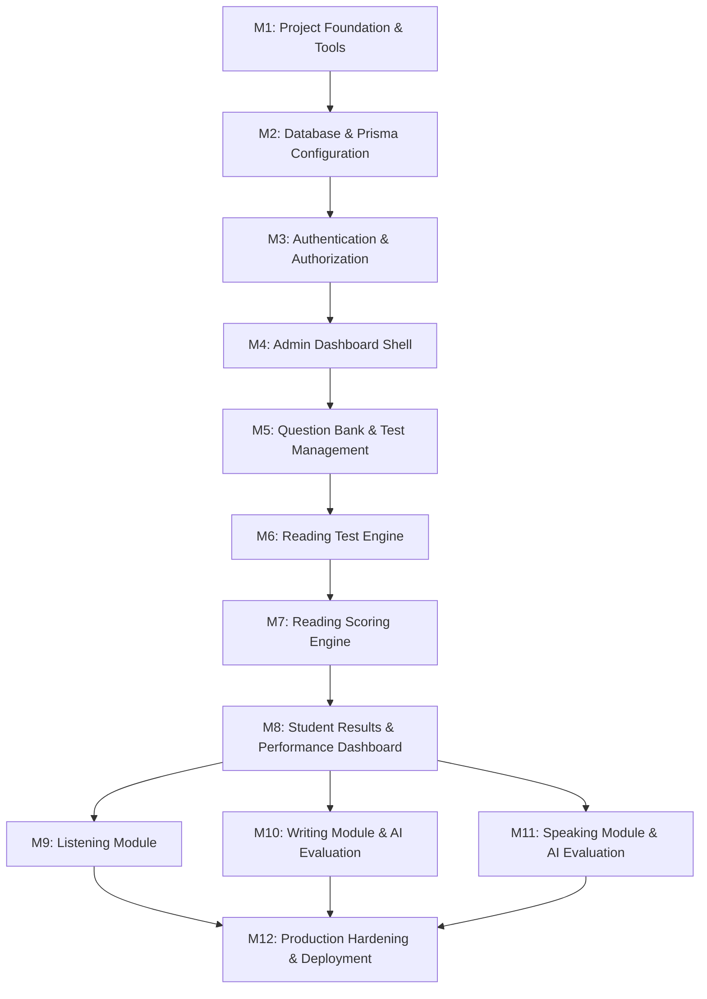

# Implementation Plan — IELTS Bangla

**Document type:** Master Engineering Roadmap & Milestone Specification  
**Project:** IELTS Bangla  
**Author:** Software Architect & Technical Lead  
**Status:** Initial Plan Proposal  
**Last updated:** 2026-11-08  

---

## 1. Roadmap Overview & Philosophy

The project follows an incremental, milestone-driven execution model. Each milestone must be independently functional, verified, type-checked, and linted before progressing.

---

## 2. Milestone Breakdown

### Milestone 1: Project Foundation & Tooling
- **Objectives:** Clean up baseline environment, align package manager (bun), establish linting and testing harness, set up design token foundation.
- **Tasks:**
  - Verify Next.js 16.4.5, React 19, and Tailwind CSS v4 setup.
  - Install Vitest and test runner compatible with Bun/Next.js for deterministic business logic unit tests.
  - Ensure `.env.example` is complete with placeholders (`DATABASE_URL`, `AUTH_SECRET`, etc.).
  - Establish base UI design tokens and layout shell (Geist font, accessible color system).
- **Dependencies:** None.
- **Deliverables:**
  - `vitest.config.mts` and initial smoke test.
  - Clean `bun run lint`, `bun run build`, and `bun test`.
  - Updated `.env.example`.
- **Acceptance Criteria:**
  - Zero TypeScript errors (`tsc --noEmit`).
  - Zero ESLint warnings or errors.
  - Unit test suite runs and passes.
- **Testing Requirements:** Vitest setup test verifying server/client utilities.

---

### Milestone 2: Database & Prisma Configuration
- **Objectives:** Establish reliable, secure, type-safe database access with Neon PostgreSQL using Prisma ORM.
- **Tasks:**
  - Install `prisma` (devDependencies) and `@prisma/client`.
  - Ensure `DATABASE_URL` is configured cleanly in `.env` without exposing secrets.
  - Write `prisma/schema.prisma` supporting Users, Tests, PublishedTestVersions, TestSections, QuestionGroups, Questions, AcceptedAnswers, TestAttempts, StudentAnswers, EvaluationResults.
  - Run initial Prisma migration against Neon PostgreSQL.
  - Build `prisma/seed.ts` to ingest Mock Test 01 from `resource/Mock_01_Test.pdf` & `resource/Mock_01_Answer_Key.pdf`.
  - Create singleton database client `lib/prisma.ts`.
- **Dependencies:** Milestone 1.
- **Deliverables:**
  - `prisma/schema.prisma`
  - `prisma/migrations/`
  - `lib/prisma.ts`
  - `prisma/seed.ts`
- **Acceptance Criteria:**
  - Prisma client generates without error.
  - Migration applies cleanly to Neon DB.
  - Seeding populates Mock Test 01 (3 passages, 40 questions, answers, rationales, band conversion table).
- **Testing Requirements:** DB connectivity integration test verifying read/write of test records.

---

### Milestone 3: Authentication & Server-Side Authorization
- **Objectives:** Provide secure authentication for Students and Admins with role-based access control.
- **Tasks:**
  - Implement secure credential-based auth using bcrypt/argon2 password hashing with secure HTTP-only cookies / JWT session management (or Auth.js v5 / Jose lightweight session).
  - Create Registration and Login forms with Zod validation.
  - Create auth helper utilities: `getCurrentUser()`, `requireAuth()`, `requireRole('ADMIN')`.
  - Add middleware/route protection for `/admin/*` and `/exam/*` and `/dashboard/*`.
- **Dependencies:** Milestone 2.
- **Deliverables:**
  - `/login` and `/register` pages.
  - Auth actions/routes.
  - Middleware route guards.
- **Acceptance Criteria:**
  - Students cannot access `/admin`.
  - Unauthenticated users cannot start test attempts.
  - Passwords hashed securely; tokens signed with secret from `.env`.
- **Testing Requirements:** Unit tests for password hashing and role-check helpers; integration tests for route protection.

---

### Milestone 4: Admin Dashboard Shell
- **Objectives:** Build the administrative back-office navigation and overview.
- **Tasks:**
  - Create `/admin` layout with sidebar navigation (Overview, Tests, Passages, Question Bank, Students, Analytics).
  - Display platform summary statistics (Total Tests, Active Attempts, Registered Students).
  - Responsive, clean UI using Tailwind CSS.
- **Dependencies:** Milestone 3.
- **Deliverables:**
  - `/admin/page.tsx`
  - Admin navigation and layout components.
- **Acceptance Criteria:**
  - Renders cleanly for ADMIN role.
  - Redirects or returns 403 for STUDENT role.
- **Testing Requirements:** Component render tests and server authorization tests.

---

### Milestone 5: Question Bank & Test Management
- **Objectives:** Allow administrators to author, edit, preview, and publish tests.
- **Tasks:**
  - CRUD operations for Tests (Draft status).
  - Passage and Question Group authoring interface (rich text or markdown passage, question prompt, option setup, word limits).
  - Accepted Answer configuration (multiple alternatives, case sensitivity flag, rationales/explanations).
  - Band conversion table editor/preview.
  - Test Publish workflow (creates immutable `PublishedTestVersion`).
- **Dependencies:** Milestone 4.
- **Deliverables:**
  - `/admin/tests/` management routes.
  - Test builder and preview UI.
  - Zod validation schemas for test authoring.
- **Acceptance Criteria:**
  - Admin can create, preview, and publish a test.
  - Publishing creates an immutable version with frozen question snapshots.
- **Testing Requirements:** Unit tests for test publishing service; validation schema tests.

---

### Milestone 6: Reading Test Engine (Student Examination Experience)
- **Objectives:** Provide a computer-delivered IELTS (CD-IELTS) testing environment.
- **Tasks:**
  - Split-screen examination layout (Passage on left, Questions on right, resizable/collapsible).
  - Countdown timer synchronized with server-authoritative `expiresAt`.
  - Interactive question renderers:
    - Multiple choice (single select radio).
    - True / False / Not Given & Yes / No / Not Given (pill radio buttons).
    - Sentence / Note / Summary completion (inline text inputs).
    - Matching Headings (dropdown selector).
  - Question Navigator bar (Questions 1–40):
    - Shows answered status, current question, and "Review" flag.
  - Debounced autosave to `/api/exam/[attemptId]/save` storing `StudentAnswer`.
  - Passage tab navigation (Passage 1, Passage 2, Passage 3).
  - Submit confirmation modal displaying warning if questions are unanswered.
  - Automatic submission when time expires.
- **Dependencies:** Milestone 5.
- **Deliverables:**
  - `/exam/[testSlug]` route.
  - Examination UI components (`ExamHeader`, `PassageViewer`, `QuestionPalette`, `QuestionRenderer`).
  - Autosave hook and server action.
- **Acceptance Criteria:**
  - State survives page refresh.
  - Answers autosave reliably within 500ms.
  - Server rejects answer updates after `expiresAt`.
- **Testing Requirements:** Frontend unit tests for timer, state persistence, and autosave throttling.

---

### Milestone 7: Reading Scoring Engine
- **Objectives:** Server-side deterministic evaluation and band calculation.
- **Tasks:**
  - Implement scoring engine `lib/scoring/reading.ts`:
    - Case-insensitive comparison.
    - Whitespace and punctuation trimming/normalization.
    - Multiple accepted answer matching (e.g. `fuel prices` vs `fuel-prices` vs `rising fuel prices`).
    - Word limit enforcement (reject answers exceeding specified word count).
    - Roman numeral normalization for Headings (`i` vs `I`).
  - Compute raw score (0–40).
  - Map raw score to estimated IELTS Band (1.0–9.0) using test-specific band table.
  - Compute section breakdowns (Passage 1, 2, 3 raw scores).
  - Store results idempotently in `EvaluationResult`.
- **Dependencies:** Milestone 6.
- **Deliverables:**
  - `lib/scoring/reading.ts`
  - `/api/exam/[attemptId]/submit` endpoint.
  - Golden test suite matching `Mock_01_Answer_Key.pdf`.
- **Acceptance Criteria:**
  - All 40 questions in Mock Test 01 score 100% when supplied with golden answers.
  - Varied whitespace, lowercase/uppercase, and accepted alternatives pass.
  - Exceeding word limit awards 0 marks.
  - Duplicate submissions return the existing `EvaluationResult`.
- **Testing Requirements:** Exhaustive unit test suite covering 20+ edge cases (misspellings, extra words, punctuation, blank answers).

---

### Milestone 8: Student Results & Performance Dashboard
- **Objectives:** Present rich exam feedback, detailed answer explanations, and historical progress.
- **Tasks:**
  - Build Exam Result page `/results/[attemptId]`:
    - Overall estimated IELTS Band badge.
    - Raw score summary (X / 40) and accuracy percentage.
    - Time spent.
    - Passage-by-passage performance breakdown.
  - Detailed Answer Review:
    - Side-by-side view of passage, student answer, correct answer, and explanation ("Where to find it / why").
    - Visual indicators (Green check for correct, Red cross for incorrect, Grey for omitted).
  - Student Dashboard `/dashboard`:
    - Historical mock test attempts list.
    - Band score trend chart over time.
    - Strengths & weaknesses by question type (e.g. True/False accuracy vs Matching Headings accuracy).
- **Dependencies:** Milestone 7.
- **Deliverables:**
  - `/results/[attemptId]/page.tsx`
  - `/dashboard/page.tsx`
  - Review components.
- **Acceptance Criteria:**
  - Student can review every question with full rationales only AFTER submission.
  - Student cannot access another student's results.
- **Testing Requirements:** Authorization tests and UI snapshot/component tests.

---

### Milestone 9: Listening Module (Phase 2)
- **Objectives:** Audio-driven 4-section IELTS Listening examination system.
- **Tasks:**
  - Audio storage and streaming setup.
  - Audio player component with one-time playback constraints or standard practice controls.
  - Listening question groups (Form completion, Map/diagram labelling, Multiple choice).
  - Timed sections and deterministic scoring engine.
- **Dependencies:** Milestone 8.

---

### Milestone 10: Writing Module & AI Evaluation (Phase 3)
- **Objectives:** Academic Writing Task 1 and Task 2 with IELTS rubric AI grading.
- **Tasks:**
  - Writing exam interface with live word count and task prompt switcher.
  - LLM evaluation adapter using IELTS 4-criteria rubrics (Task Achievement, Coherence & Cohesion, Lexical Resource, Grammatical Range & Accuracy).
  - Structured feedback, identified weaknesses, and improvement suggestions.
- **Dependencies:** Milestone 8.

---

### Milestone 11: Speaking Module & AI Evaluation (Phase 4)
- **Objectives:** Browser-based speaking test with audio recording, transcription, and multimodal evaluation.
- **Tasks:**
  - Audio recording in browser using MediaRecorder API.
  - Audio upload to cloud object storage.
  - Speech-to-text transcription.
  - Pronunciation analysis using audio acoustic features (never transcript alone).
  - 4-criteria evaluation.
- **Dependencies:** Milestone 8.

---

### Milestone 12: Production Hardening, Security & Deployment
- **Objectives:** Final security auditing, performance optimizations, database indexes, and deployment to production.
- **Tasks:**
  - Audit rate limiting, CSRF, and SQL injection protections.
  - Optimize asset caching and serverless cold starts.
  - Perform load and accessibility (WCAG 2.1 AA) audits.
  - Configure production deployment on Vercel or cloud provider.
- **Dependencies:** Milestones 1–8.
