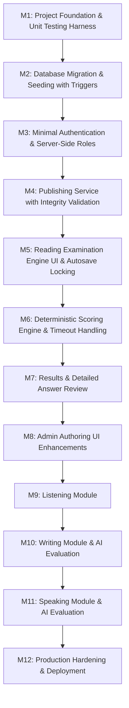

# Implementation Plan — IELTS Bangla

**Document type:** Master Engineering Roadmap & Milestone Specification  
**Project:** IELTS Bangla  
**Author:** Software Architect & Technical Lead  
**Status:** Final Pre-Migration Roadmap  
**Last updated:** 2026-11-08  

---

## 1. Roadmap Strategy & MVP Focus

The primary directive is shipping a working, robust, verifiable **Reading MVP** before expanding into secondary features or administrative dashboards. Development progresses through tightly-scoped, independently testable milestones.

---

## 2. Milestone Breakdown

### Milestone 1: Project Foundation & Tooling
- **Objectives:** Establish the developer toolchain, testing harness, and clean environment baseline.
- **Tasks:**
  - Verify Next.js 16.4.5, React 19, and Tailwind CSS v4 setup.
  - Install and configure `vitest` with `@testing-library/react` for fast, bun-compatible unit tests.
  - Set up base UI tokens, layout shell, and typography (Geist font).
  - Verify `.env.example` contains safe placeholder values.
- **Deliverables:**
  - `vitest.config.mts`
  - Smoke test suite verifying test runner.
  - Passing `bun run lint` and `bun run build`.
- **Acceptance Criteria:** Zero linting/type errors; test harness runs with `bun test`.

---

### Milestone 2: Database Migration & Seeding with Triggers
- **Objectives:** Apply the normalized Prisma schema to Neon PostgreSQL, attach PostgreSQL immutability triggers, and seed Mock Test 01.
- **Tasks:**
  - Generate initial migration with `prisma migrate dev --create-only`.
  - Append the PostgreSQL immutability triggers (`protect_published_test_version` and `protect_published_child_record`) directly to the migration SQL file.
  - Apply migration to Neon PostgreSQL.
  - Create database client singleton `lib/prisma.ts`.
  - Implement seed script `prisma/seed.ts` to ingest `Mock_01_Test.pdf` and `Mock_01_Answer_Key.pdf` into a complete, verified `PublishedTestVersion`.
- **Deliverables:**
  - `lib/prisma.ts`
  - `prisma/migrations/*_init_reading_schema/migration.sql`
  - `prisma/seed.ts`
- **Acceptance Criteria:**
  - Migration runs against Neon PostgreSQL without data loss.
  - Triggers are active and verified: attempting to UPDATE or DELETE a published section/question/answer fails with PostgreSQL exception.
  - Seeder populates Mock Test 01 (3 passages, 40 questions, answers, rationales, and exact band conversion table).
- **Testing Requirements:** Integration test verifying relational queries across the version-locked hierarchy and verifying trigger immutability enforcement.

---

### Milestone 3: Minimal Authentication & Server-Side Roles
- **Objectives:** Implement secure, lightweight, stateless session authentication for Students and Admins.
- **Tasks:**
  - Implement password hashing with `bcryptjs`.
  - Implement session management using signed HTTP-only cookies via `jose`.
  - Create registration endpoint (`/api/auth/register`) strictly enforcing `Role.STUDENT` (strips any requested role).
  - Create login endpoint (`/api/auth/login`) with credential and deactivation checks.
  - Create server authorization helpers: `getCurrentUser()`, `requireAuth()`, `requireRole('ADMIN')`.
- **Deliverables:**
  - `/login` and `/register` pages.
  - `lib/auth/session.ts` and `lib/auth/guards.ts`.
- **Acceptance Criteria:**
  - Passwords stored securely as bcrypt hashes.
  - Protected routes reject unauthenticated requests.
  - Deactivated users cannot log in.
- **Testing Requirements:** Unit tests for session issuance/verification; integration tests for route protection.

---

### Milestone 4: Publishing Service with Integrity Validation
- **Objectives:** Implement backend service to validate draft test content and publish immutable version snapshots.
- **Tasks:**
  - Implement publishing service `lib/services/testPublishing.ts`:
    - Validates exact total question count.
    - Validates continuous question numbering (1 to `totalQuestions` without gaps or duplicates).
    - Validates structural completeness (every section has groups, every group has questions, every question has accepted answers).
    - Validates question options and word limits.
    - Validates band conversion table completeness (covers 0 to `totalQuestions` continuously, bands 0.0 to 9.0).
    - Deep-copies draft sections, groups, questions, and accepted answers into `Published*` models in a single atomic database transaction.
    - Increments `versionNumber`.
- **Deliverables:**
  - `lib/services/testPublishing.ts`
  - Unit tests verifying snapshot deep copy, validation failure rollbacks, and constraint enforcement.
- **Acceptance Criteria:**
  - Invalid draft cannot produce a partial published version.
  - Question number uniqueness and continuity are strictly enforced.

---

### Milestone 5: Reading Examination Engine (Student Experience)
- **Objectives:** Build the core computer-delivered IELTS (CD-IELTS) testing environment.
- **Tasks:**
  - Examination split-screen layout:
    - Left pane: Passage text with clear paragraph labeling (A, B, C...).
    - Right pane: Interactive question rendering.
    - Configurable layout: Accommodates any number of passages and questions defined by the test version.
  - Authoritative countdown timer synchronized with server-issued `expiresAt`.
  - Duplicate active attempt prevention (at most one active `IN_PROGRESS` attempt per test).
  - Interactive question renderers:
    - Multiple choice (single select radio).
    - True / False / Not Given & Yes / No / Not Given (pill radio buttons).
    - Sentence / Note / Summary completion (inline text inputs).
    - Matching Headings (dropdown selectors).
  - Question palette navigation (1 to 40) with visual states: Unattempted, Answered, Flagged for Review.
  - Debounced autosave to `/api/exam/[attemptId]/save` using `SELECT ... FOR UPDATE` row locking:
    - Rejects writes if attempt is finalized or `now >= expiresAt`.
  - Submission modal with warnings for unattempted questions.
- **Deliverables:**
  - `/exam/[testSlug]` examination page and components.
  - `hooks/useExamAutosave.ts` and `hooks/useExamTimer.ts`.
- **Acceptance Criteria:**
  - Answers persist across page reloads.
  - Timer enforces authoritative expiration without client clock trust.
  - Autosave throttles safely with row-level locking.
- **Testing Requirements:** Component render tests, timer synchronization tests, and autosave race-condition integration tests.

---

### Milestone 6: Deterministic Scoring Engine & Timeout Handling
- **Objectives:** Deliver 100% deterministic, test-calibrated server-side scoring and transaction-safe finalization.
- **Tasks:**
  - Pure scoring engine `lib/scoring/reading.ts`:
    - Normalized string matching: case-insensitive, trimmed whitespace, normalized punctuation.
    - Explicit alternative answer support (e.g. `x / y` or `[x, y]`).
    - Strict word count limit enforcement (reject answers exceeding limit).
    - Roman numeral normalization (`i` vs `I`).
  - Shared finalization service `lib/services/attemptFinalizer.ts`:
    - Handles both manual submission (`SUBMITTED`) and timeout expiration (`TIMED_OUT`).
    - If manual submission arrives after deadline (`now > expiresAt`), automatically routes through timeout finalization.
    - Single transaction executes status transition, answer scoring, and `EvaluationResult` insertion.
    - Rollback ensures attempt is never left in dangling finalized state without evaluation.
    - Mutex pattern prevents concurrent duplicate scoring.
    - Calculates estimated IELTS band using version-specific `bandConversionTable`.
- **Deliverables:**
  - `lib/scoring/reading.ts`
  - `lib/services/attemptFinalizer.ts`
  - Golden test suite matching `Mock_01_Answer_Key.pdf`.
- **Acceptance Criteria:**
  - All 40 questions of Mock Test 01 score 100% with golden answers.
  - Edge cases (whitespace, capitalization, accepted variants) score accurately.
  - Exceeding word limit awards 0 marks.
  - Late manual submission transitions to `TIMED_OUT` and scores saved answers.
- **Testing Requirements:** Exhaustive unit test suite covering 20+ scoring edge cases.

---

### Milestone 7: Results & Detailed Answer Review
- **Objectives:** Present students with clear diagnostic feedback, band visualization, and question rationales.
- **Tasks:**
  - Result overview page `/results/[attemptId]`:
    - Prominent estimated IELTS Band badge.
    - Raw score summary (X / 40) and accuracy percentage.
    - Passage-by-passage performance breakdown.
    - Authoritative time spent.
  - Detailed Answer Review UI:
    - Side-by-side view: Passage, Student Answer, Correct Answer(s), and Explanation ("Where to find it / why").
    - Visual indicators (Green check, Red cross, Grey dash for unanswered).
- **Deliverables:**
  - `/results/[attemptId]/page.tsx`
  - Review components.
- **Acceptance Criteria:**
  - Answer keys and rationales are visible only after finalization.
  - Students cannot view other students' attempts.

---

### Milestone 8: Admin Authoring UI Enhancements
- **Objectives:** Build user-friendly admin interfaces to create and edit tests without direct database manipulation.
- **Tasks:**
  - Draft test builder UI (edit passages, groups, questions, and accepted answers).
  - Draft preview mode.
  - Version publishing trigger with validation reporting.

---

### Milestones 9–12: Future Phases
- **M9:** Listening Module (Audio streaming, playback limits, timed sections).
- **M10:** Writing Module & AI Evaluation (Task 1 & 2 editors, IELTS 4-criteria LLM rubrics).
- **M11:** Speaking Module & AI Evaluation (Browser audio recording, speech-to-text, acoustic pronunciation analysis).
- **M12:** Production Hardening, Security Audit & Deployment.
