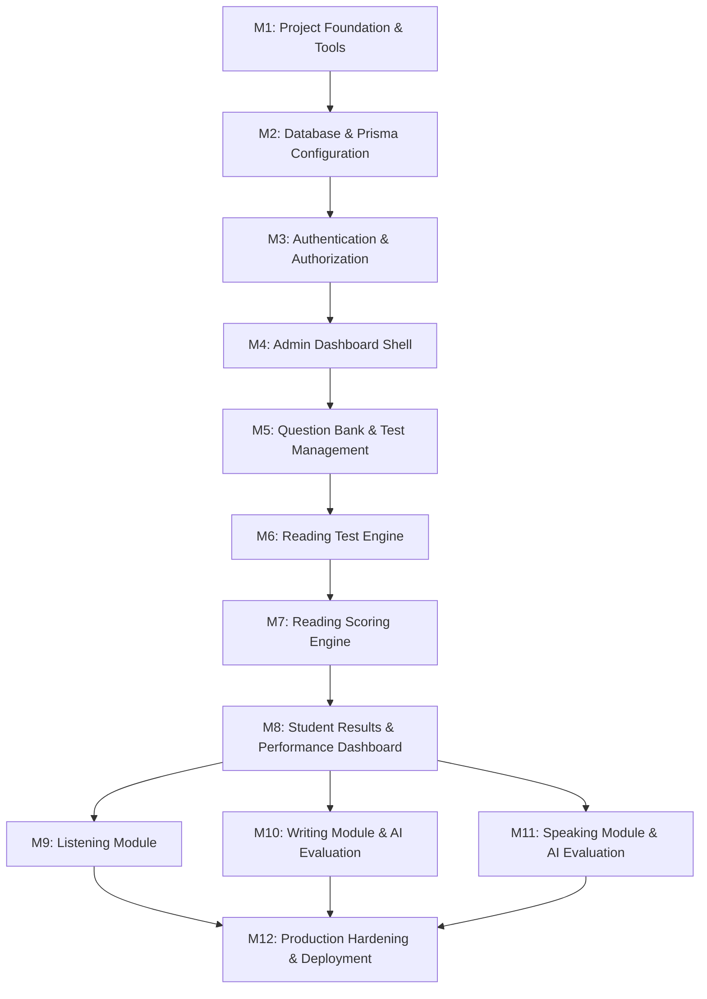

# Implementation Plan — IELTS Bangla (Revised)

**Document type:** Master Engineering Roadmap & Milestone Specification  
**Project:** IELTS Bangla  
**Author:** Software Architect & Technical Lead  
**Status:** Revised Plan Proposal  
**Last updated:** 2026-11-08  

---

## 1. Roadmap Overview & Philosophy

The project follows an incremental, milestone-driven execution model. Each milestone must be independently functional, verified, type-checked, and linted before progressing.

---

## 2. Milestone Breakdown

### Milestone 1: Project Foundation & Tooling
- **Objectives:** Clean up baseline environment, align package manager (bun), establish linting and testing harness, set up design token foundation.
- **Tasks:**
  - Verify Next.js 16.4.5, React 19, and Tailwind CSS v4 setup.
  - Install Vitest and test runner compatible with Bun/Next.js for deterministic business logic unit tests.
  - Ensure `.env.example` is complete with placeholders (`DATABASE_URL`, `AUTH_SECRET`, etc.).
  - Establish base UI design tokens and layout shell (Geist font, accessible color system).
- **Dependencies:** None.
- **Deliverables:**
  - `vitest.config.mts` and initial smoke test.
  - Clean `bun run lint`, `bun run build`, and `bun test`.
  - Updated `.env.example`.
- **Acceptance Criteria:**
  - Zero TypeScript errors (`tsc --noEmit`).
  - Zero ESLint warnings or errors.
  - Unit test suite runs and passes.
- **Testing Requirements:** Vitest setup test verifying server/client utilities.

---

### Milestone 2: Database & Prisma Configuration (Revised)
- **Objectives:** Establish reliable, secure, type-safe database access with Neon PostgreSQL using Prisma ORM with draft/published separation and composite foreign key integrity.
- **Tasks:**
  - Install `prisma` (devDependencies) and `@prisma/client`.
  - Ensure `DATABASE_URL` is configured in `.env` without exposing secrets.
  - Implement `prisma/schema.prisma` featuring:
    - User model with extensible auth/profile fields.
    - Editable draft tree: `Test`, `DraftSection`, `DraftQuestionGroup`, `DraftQuestion`, `DraftAcceptedAnswer`.
    - Immutable published tree: `PublishedTestVersion`, `PublishedSection`, `PublishedQuestionGroup`, `PublishedQuestion`, `PublishedAcceptedAnswer`.
    - Composite unique and foreign key constraints on `StudentAnswer(attemptId, testVersionId)` and `StudentAnswer(questionId, testVersionId)`.
    - Question number uniqueness `@@unique([testVersionId, questionNumber])`.
  - Generate Prisma Client and create migration.
  - Build `prisma/seed.ts` to ingest Mock Test 01 from `resource/Mock_01_Test.pdf` & `resource/Mock_01_Answer_Key.pdf` into both draft and initial published version 1.
  - Create singleton database client `lib/prisma.ts`.
- **Dependencies:** Milestone 1.
- **Deliverables:**
  - `prisma/schema.prisma`
  - `prisma/migrations/`
  - `lib/prisma.ts`
  - `prisma/seed.ts`
- **Acceptance Criteria:**
  - Prisma client generates without error.
  - Migration applies cleanly to Neon DB.
  - Seeding populates Mock Test 01 (3 passages, 40 continuous questions, exact accepted answers, rationales, and calibrated band conversion table).
- **Testing Requirements:** DB connectivity integration test verifying that cross-version student answer insertions are rejected by the database.

---

### Milestone 3: Authentication & Server-Side Authorization
- **Objectives:** Provide secure authentication for Students and Admins with role-based access control.
- **Tasks:**
  - Implement secure credential-based auth using bcrypt password hashing with secure HTTP-only cookies and lightweight edge-compatible JWT session management via `jose`.
  - Create Registration and Login forms with Zod validation.
  - Create auth helper utilities: `getCurrentUser()`, `requireAuth()`, `requireRole('ADMIN')`.
  - Add middleware/route protection for `/admin/*`, `/exam/*`, and `/dashboard/*`.
- **Dependencies:** Milestone 2.
- **Deliverables:**
  - `/login` and `/register` pages.
  - Auth actions/routes.
  - Middleware route guards.
- **Acceptance Criteria:**
  - Students cannot access `/admin`.
  - Unauthenticated users cannot start test attempts.
  - Passwords hashed securely; tokens signed with secret from `.env`.
- **Testing Requirements:** Unit tests for password hashing and role-check helpers; integration tests for route protection.

---

### Milestone 4: Admin Dashboard Shell
- **Objectives:** Build the administrative back-office navigation and overview.
- **Tasks:**
  - Create `/admin` layout with sidebar navigation (Overview, Tests, Passages, Question Bank, Students, Analytics).
  - Display platform summary statistics (Total Tests, Active Attempts, Registered Students).
  - Responsive, clean UI using Tailwind CSS.
- **Dependencies:** Milestone 3.
- **Deliverables:**
  - `/admin/page.tsx`
  - Admin navigation and layout components.
- **Acceptance Criteria:**
  - Renders cleanly for ADMIN role.
  - Redirects or returns 403 for STUDENT role.
- **Testing Requirements:** Component render tests and server authorization tests.

---

### Milestone 5: Question Bank & Test Management (Authoring & Publishing)
- **Objectives:** Allow administrators to author, edit, preview, and publish tests using the draft/published snapshot pipeline.
- **Tasks:**
  - Draft authoring CRUD: Passages, Question Groups, Questions, Accepted Answers, Explanations.
  - Admin preview interface rendering the draft exactly as a student would see it.
  - Publish transaction service:
    - Pre-flight checks: All 3 passages present, continuous questions 1 to 40, all accepted answers configured, valid band table.
    - Deep-copies draft tree into `PublishedTestVersion` snapshot.
    - Increments `versionNumber`.
- **Dependencies:** Milestone 4.
- **Deliverables:**
  - `/admin/tests/` management routes.
  - Draft authoring UI & publish button with validation modal.
  - Zod validation schemas for test authoring.
- **Acceptance Criteria:**
  - Admin can author, preview, and publish a test.
  - Published versions are frozen; editing the draft does not mutate the published version.
- **Testing Requirements:** Unit tests for test publishing service; validation schema tests.

---

### Milestone 6: Reading Test Engine (Student Examination Experience)
- **Objectives:** Provide an authentic, computer-delivered IELTS (CD-IELTS) testing environment.
- **Tasks:**
  - Split-screen examination layout (Passage on left with paragraph markers A–G, Questions on right).
  - Countdown timer synchronized with server-authoritative `expiresAt`.
  - Interactive question renderers:
    - Multiple choice (single select radio).
    - True / False / Not Given & Yes / No / Not Given (pill radio buttons).
    - Sentence / Note / Summary completion (inline text inputs).
    - Matching Headings (dropdown selector).
  - Question Navigator bar (Questions 1–40):
    - Shows answered status, current question, and "Review" flag.
  - Debounced autosave to `/api/exam/[attemptId]/save` storing `StudentAnswer(attemptId, testVersionId, questionId)`.
  - Passage tab navigation (Passage 1, Passage 2, Passage 3).
  - Submit confirmation modal displaying warning if questions are unanswered.
  - Automatic submission when server expiration is reached.
- **Dependencies:** Milestone 5.
- **Deliverables:**
  - `/exam/[testSlug]` route.
  - Examination UI components (`ExamHeader`, `PassageViewer`, `QuestionPalette`, `QuestionRenderer`).
  - Autosave hook and server action.
- **Acceptance Criteria:**
  - State survives page refresh.
  - Answers autosave reliably within 500ms.
  - Server rejects answer updates after `expiresAt`.
- **Testing Requirements:** Frontend unit tests for timer, state persistence, and autosave throttling.

---

### Milestone 7: Reading Scoring Engine (Strict, Deterministic)
- **Objectives:** Server-side deterministic evaluation and band calculation without fuzzy matching.
- **Tasks:**
  - Implement scoring engine `lib/scoring/reading.ts`:
    - Strict whitespace normalization (trim + collapse consecutive spaces).
    - Unicode case insensitivity (unless `isCaseSensitive: true`).
    - Multiple accepted answer matching (matching explicit `AcceptedAnswer` records only).
    - Word limit enforcement (reject answers exceeding specified word count with score 0).
    - Roman numeral normalization for Headings (`i` vs `I`).
  - Idempotent submission transaction:
    - Conditional locking on `status = 'IN_PROGRESS'`.
    - Idempotent return of existing `EvaluationResult` on duplicate submission.
  - Calculate `rawScore` (0–40) and map to `estimatedBand` (1.0–9.0) using test-specific band table.
  - Store results in `EvaluationResult`.
- **Dependencies:** Milestone 6.
- **Deliverables:**
  - `lib/scoring/reading.ts`
  - `/api/exam/[attemptId]/submit` endpoint.
  - Golden test suite matching `Mock_01_Answer_Key.pdf`.
- **Acceptance Criteria:**
  - All 40 questions in Mock Test 01 score 100% when supplied with golden answers.
  - Varied whitespace, lowercase/uppercase, and accepted alternatives pass.
  - Exceeding word limit awards 0 marks.
  - Duplicate submissions return the existing `EvaluationResult`.
- **Testing Requirements:** Exhaustive unit test suite covering 20+ edge cases (misspellings, extra words, punctuation, blank answers).

---

### Milestone 8: Student Results & Performance Dashboard
- **Objectives:** Present rich exam feedback, detailed answer explanations, and historical progress.
- **Tasks:**
  - Build Exam Result page `/results/[attemptId]`:
    - Overall estimated IELTS Band badge.
    - Raw score summary (X / 40) and accuracy percentage.
    - Time spent.
    - Passage-by-passage performance breakdown.
  - Detailed Answer Review:
    - Side-by-side view of passage, student answer, correct answer, and explanation ("Where to find it / why").
    - Visual indicators (Green check for correct, Red cross for incorrect, Grey for omitted).
  - Student Dashboard `/dashboard`:
    - Historical mock test attempts list.
    - Band score trend chart over time.
    - Strengths & weaknesses by question type.
- **Dependencies:** Milestone 7.
- **Deliverables:**
  - `/results/[attemptId]/page.tsx`
  - `/dashboard/page.tsx`
  - Review components.
- **Acceptance Criteria:**
  - Student can review every question with full rationales only AFTER submission.
  - Student cannot access another student's results.
- **Testing Requirements:** Authorization tests and UI snapshot/component tests.

---

### Milestone 9: Listening Module (Phase 2)
- **Objectives:** Audio-driven 4-section IELTS Listening examination system.

---

### Milestone 10: Writing Module & AI Evaluation (Phase 3)
- **Objectives:** Academic Writing Task 1 and Task 2 with IELTS rubric AI grading.

---

### Milestone 11: Speaking Module & AI Evaluation (Phase 4)
- **Objectives:** Browser-based speaking test with audio recording, transcription, and multimodal evaluation.

---

### Milestone 12: Production Hardening, Security & Deployment
- **Objectives:** Final security auditing, performance optimizations, database indexes, and deployment to production.
