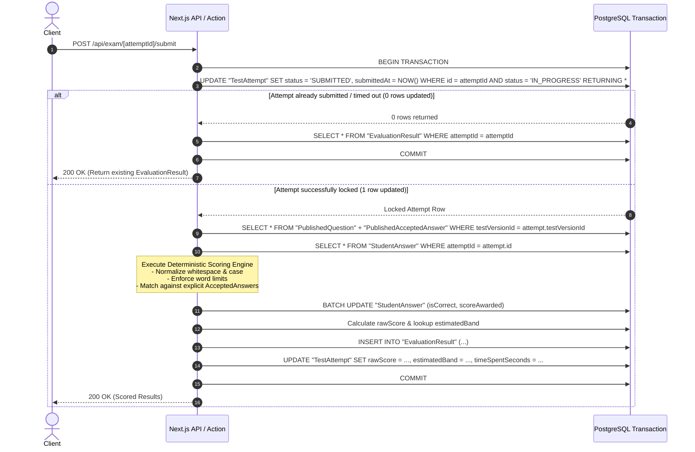

# Database Architecture & Design — IELTS Bangla (Revised)

**Document type:** Living Database Specification  
**Project:** IELTS Bangla  
**Author:** Software Architect & Database Engineer  
**Status:** Revised Architecture Proposal (Phase 1: Reading MVP)  
**Last updated:** 2026-11-08  

---

## 1. Overview & Architectural Principles

The database schema is engineered specifically for an online, computer-delivered IELTS (CD-IELTS) testing system where **correctness, examination integrity, referential consistency, and historical auditability** are paramount.

### Core Architectural Principles:

1. **Strict Separation of Drafts and Published Snapshots:**
   - **Drafts (`Test`, `DraftSection`, `DraftQuestionGroup`, `DraftQuestion`, `DraftAcceptedAnswer`):** Fully mutable by administrators. Used to author, revise, reorder, preview, and refine test passages, questions, and explanations.
   - **Published Snapshots (`PublishedTestVersion`, `PublishedSection`, `PublishedQuestionGroup`, `PublishedQuestion`, `PublishedAcceptedAnswer`):** Frozen, immutable snapshots created at publication time.
   - Once a version is published, it is never mutated in place. If an administrator edits the draft and publishes again, a new version snapshot (`versionNumber = 2`) is generated.
2. **Cross-Table Referential Integrity (Version Pinning):**
   - A `StudentAnswer` cannot reference a question belonging to another test version. This is enforced at the database engine level via composite foreign keys sharing `testVersionId`.
3. **Continuous Question Number Uniqueness:**
   - IELTS Reading tests are numbered continuously from 1 to 40 across all three passages. A unique constraint on `(testVersionId, questionNumber)` guarantees that no test version contains duplicate question numbers or numbering gaps.
4. **Authoritative Server Timestamps:**
   - Client clocks are untrusted. Test duration, expiration, remaining time, and submission validity are computed and enforced solely using database-recorded server timestamps (`startedAt`, `expiresAt`, `submittedAt`).
5. **Deterministic, Non-Fuzzy Scoring:**
   - Only explicitly configured accepted answers are credited. No fuzzy, phonetic (Soundex), stemming, or semantic matching is permitted. Whitespace normalization, case insensitivity, and word count enforcement are strictly applied.
6. **Idempotent, Transaction-Safe Submission:**
   - Atomic conditional transitions prevent duplicate scoring and race conditions under network retries or repeated submission clicks.

---

## 2. Relational Architecture Diagram

```mermaid
erDiagram
    User ||--o{ TestAttempt : "takes"
    
    Test ||--o{ DraftSection : "drafts"
    DraftSection ||--o{ DraftQuestionGroup : "contains"
    DraftQuestionGroup ||--o{ DraftQuestion : "contains"
    DraftQuestion ||--o{ DraftAcceptedAnswer : "accepts"

    Test ||--o{ PublishedTestVersion : "publishes (1..N)"
    PublishedTestVersion ||--o{ PublishedSection : "freezes"
    PublishedSection ||--o{ PublishedQuestionGroup : "freezes"
    PublishedQuestionGroup ||--o{ PublishedQuestion : "freezes"
    PublishedQuestion ||--o{ PublishedAcceptedAnswer : "freezes"

    PublishedTestVersion ||--o{ TestAttempt : "attemped via"
    TestAttempt ||--o{ StudentAnswer : "submits"
    PublishedQuestion ||--o{ StudentAnswer : "evaluates"
    TestAttempt ||--o| EvaluationResult : "scores"

    User {
        string id PK
        string email UK
        string name
        string passwordHash
        enum role "STUDENT, ADMIN"
        datetime emailVerified
        string phone
        float targetBand
        datetime examDate
        boolean isActive
    }

    Test {
        string id PK
        string title
        string slug UK
        enum module "READING"
        enum category "ACADEMIC, GENERAL_TRAINING"
        int durationMinutes
        int totalQuestions
        boolean isPublished
    }

    PublishedTestVersion {
        string id PK
        string testId FK
        int versionNumber
        string title
        int durationMinutes
        int totalQuestions
        json bandConversionTable
        boolean isArchived
        datetime publishedAt
    }

    PublishedQuestion {
        string id PK
        string testVersionId FK
        string questionGroupId FK
        int questionNumber UK_per_version
        string prompt
        json options
        string explanation
    }

    TestAttempt {
        string id PK
        string userId FK
        string testVersionId FK
        enum status "IN_PROGRESS, SUBMITTED, TIMED_OUT, ABANDONED"
        datetime startedAt
        datetime expiresAt
        datetime submittedAt
        int timeSpentSeconds
        int rawScore
        float estimatedBand
    }

    StudentAnswer {
        string id PK
        string attemptId FK
        string testVersionId FK
        string questionId FK
        string answerText
        boolean isFlaggedForReview
        boolean isCorrect
        int scoreAwarded
        datetime lastSavedAt
    }

    EvaluationResult {
        string id PK
        string attemptId FK,UK
        int totalQuestions
        int totalAttempted
        int totalCorrect
        int totalIncorrect
        int rawScore
        float estimatedBand
        json sectionBreakdown
        datetime evaluatedAt
    }
```

---

## 3. Critical Relational Constraints & Guarantees

### 3.1. Enforcing Version Integrity on Student Answers

**Problem:** In a naive schema, `StudentAnswer` references `attemptId` and `questionId`. A compromised client or code defect could submit an `attemptId` belonging to Test Version 1 with a `questionId` belonging to Test Version 2, corrupting scoring and analytics.

**Solution:** Composite Foreign Key Constraints.
1. `TestAttempt` defines a unique constraint on `(id, testVersionId)`.
2. `PublishedQuestion` defines a unique constraint on `(id, testVersionId)`.
3. `StudentAnswer` stores `attemptId`, `testVersionId`, and `questionId`.
4. `StudentAnswer` declares two composite foreign keys:
   ```sql
   FOREIGN KEY (attemptId, testVersionId)
     REFERENCES "TestAttempt"(id, "testVersionId")
     ON DELETE CASCADE;

   FOREIGN KEY (questionId, testVersionId)
     REFERENCES "PublishedQuestion"(id, "testVersionId")
     ON DELETE RESTRICT;
   ```
**Mathematical Guarantee:** Because both foreign keys share the identical `testVersionId` attribute on `StudentAnswer`, it is physically impossible for a student answer to reference a question belonging to any test version other than the one bound to the attempt.

### 3.2. Question Numbering Uniqueness

In IELTS Academic Reading, questions run continuously from 1 to 40 (Passage 1: 1–13, Passage 2: 14–26, Passage 3: 27–40).
- We enforce:
  ```prisma
  @@unique([testVersionId, questionNumber])
  ```
- No duplicate question numbers can exist within the same version.
- Publishing validation verifies that questions form a contiguous set from 1 to `totalQuestions` (40).

### 3.3. Protection of Published Versions from Modification and Deletion

1. **Referential Restriction (`onDelete: Restrict`):**
   - `TestAttempt` references `PublishedTestVersion` with `onDelete: Restrict`.
   - `StudentAnswer` references `PublishedQuestion` with `onDelete: Restrict`.
   - Once a student initiates an attempt, PostgreSQL will reject any `DELETE` operation on that `PublishedTestVersion` or its child questions.
2. **Draft Deletion Protection:**
   - `PublishedTestVersion` references `Test` with `onDelete: Restrict`. An administrator cannot delete a parent `Test` if published versions with user attempts exist.
3. **Application Immutability:**
   - The application exposes zero `UPDATE` or `DELETE` endpoints for published versions, sections, question groups, questions, or accepted answers.
   - The only permissible administrative action on a published version is setting `isArchived: true` (soft archive) to hide it from new student attempt listings.

---

## 4. Transaction Strategy & Idempotency

### 4.1. Safe, Idempotent Submission & Scoring Transaction

When a student clicks "Submit" or when the server auto-submits an expired test:



### 4.2. Atomic Autosave (`saveAnswer`)

- Autosave uses an atomic upsert on `StudentAnswer` indexed by `(attemptId, questionId)`.
- Condition: The attempt must be `IN_PROGRESS` and `NOW() <= expiresAt + GRACE_PERIOD (5 seconds)`.
- If expired, the mutation is rejected with `403 Forbidden: Attempt has expired`.

---

## 5. Strict Scoring Rules (No Fuzzy Matching)

The scoring engine adheres strictly to deterministic IELTS marking principles:

1. **No Fuzzy / Semantic Matching:**
   - No Levenshtein distance, phonetic algorithms (Soundex), stemming, or LLM-based approximations.
   - A student answer is correct if and only if its normalized string matches an explicit `AcceptedAnswer` record configured for that question.
2. **Whitespace Normalization:**
   - Leading and trailing spaces are trimmed.
   - Internal sequences of whitespace (spaces, tabs, newlines) are collapsed into a single ASCII space ` ` (e.g. `"mass   production"` $\rightarrow$ `"mass production"`).
3. **Case Insensitivity:**
   - Normalized strings are compared case-insensitively using unicode-aware lowercasing, unless `isCaseSensitive: true` is explicitly marked on `AcceptedAnswer`.
   - Examples: `"FALSE"` matches `"false"` and `"False"`. `"iii"` matches `"III"`.
4. **Word Limit Enforcement:**
   - Questions specifying word constraints (e.g., `NO MORE THAN TWO WORDS`) are strictly checked:
     ```ts
     const wordCount = answerText.trim().split(/\s+/).length;
     if (group.wordLimit && wordCount > group.wordLimit) {
       return { isCorrect: false, score: 0 }; // Exceeding word limit is strictly 0 marks
     }
     ```
   - Hyphenated words (e.g. `air-filled`, `life-cycle`) count as a single word in standard IELTS rules. Both hyphenated and spaced variants must be explicitly recorded in `AcceptedAnswer` if acceptable.
5. **Alternative Accepted Answers:**
   - Multiple valid answers (e.g. `fuel prices` vs `rising fuel prices`) must each be stored as separate `AcceptedAnswer` rows.

---

## 6. Official Band Conversion Matrix (Mock Test 01)

Inspected directly from `resource/Mock_01_Answer_Key.pdf` (Page 3).

| Raw Score (out of 40) | Estimated IELTS Band | Official Calibration Note |
| :---: | :---: | :--- |
| **39–40** | **9.0** | Expert User |
| **37–38** | **8.5** | Very Good User |
| **35–36** | **8.0** | Very Good User |
| **33–34** | **7.5** | Good User |
| **30–32** | **7.0** | Good User |
| **27–29** | **6.5** | Competent User |
| **23–26** | **6.0** | Competent User |
| **19–22** | **5.5** | Modest User |
| **15–18** | **5.0** | Modest User |
| **13–14** | **4.5** | Limited User |
| **10–12** | **4.0** | Limited User |
| **8–9** | **3.5** | Extremely Limited User |
| **6–7** | **3.0** | Extremely Limited User |
| **4–5** | **2.5** | Intermittent User (Official lower-bound extension) |
| **2–3** | **2.0** | Intermittent User (Official lower-bound extension) |
| **1** | **1.0** | Non User |
| **0** | **0.0** | Did not attempt |

### JSON Schema in `PublishedTestVersion.bandConversionTable`:
```json
{
  "testSlug": "academic-reading-mock-01",
  "totalMarks": 40,
  "ranges": [
    { "min": 39, "max": 40, "band": 9.0 },
    { "min": 37, "max": 38, "band": 8.5 },
    { "min": 35, "max": 36, "band": 8.0 },
    { "min": 33, "max": 34, "band": 7.5 },
    { "min": 30, "max": 32, "band": 7.0 },
    { "min": 27, "max": 29, "band": 6.5 },
    { "min": 23, "max": 26, "band": 6.0 },
    { "min": 19, "max": 22, "band": 5.5 },
    { "min": 15, "max": 18, "band": 5.0 },
    { "min": 13, "max": 14, "band": 4.5 },
    { "min": 10, "max": 12, "band": 4.0 },
    { "min": 8,  "max": 9,  "band": 3.5 },
    { "min": 6,  "max": 7,  "band": 3.0 },
    { "min": 4,  "max": 5,  "band": 2.5 },
    { "min": 2,  "max": 3,  "band": 2.0 },
    { "min": 1,  "max": 1,  "band": 1.0 },
    { "min": 0,  "max": 0,  "band": 0.0 }
  ]
}
```

---

## 7. Complete Prisma Schema (`prisma/schema.prisma`)

*(See complete file in `prisma/schema.prisma`)*
