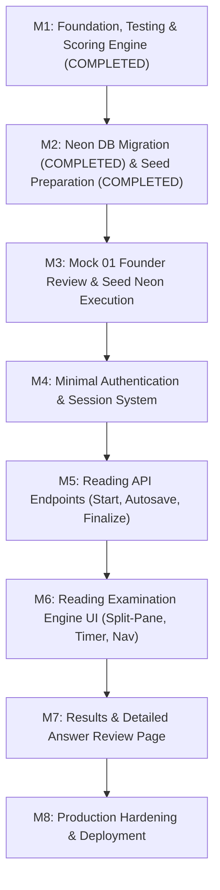

# Implementation Plan — IELTS Bangla

**Document type:** Master Engineering Roadmap & Milestone Specification  
**Project:** IELTS Bangla  
**Author:** Software Architect & Technical Lead  
**Status:** Phase 1 (Reading MVP) — Testing, Content Extraction & Seed Staged  
**Last updated:** 2026-11-08  

---

## 1. Roadmap Strategy & MVP Focus

The primary directive is shipping a working, robust, verifiable **Reading MVP** before expanding into secondary features or administrative dashboards. Development progresses through tightly-scoped, independently testable milestones.

---

## 2. Milestone Breakdown

### Milestone 1: Foundation, Testing Harness & Pure Scoring Engine (COMPLETED)
- **Status:** COMPLETED
- **Achievements:**
  - Configured `vitest@5.1.0` with `@/*` path mapping in `vitest.config.mts`.
  - Added `"test": "vitest run"` and `"test:watch": "vitest"` scripts to `package.json`.
  - Implemented pure scoring engine: `lib/scoring/normalize.ts`, `lib/scoring/wordLimit.ts`, `lib/scoring/band.ts`, and `lib/scoring/reading.ts`.
  - Comprehensive unit test suite in `lib/scoring/__tests__/scoring.test.ts` (15 tests passing).

---

### Milestone 2: Database Migration & Mock Test 01 Seed (MIGRATION COMPLETE, SEED PREPARED)
- **Status:** MIGRATION COMPLETE, SEED STAGED & VERIFIED
- **Achievements:**
  - Initial migration applied to dedicated `ielts_bangla` Neon database (`20261108000000_init_reading_schema`).
  - Immutability and TRUNCATE triggers, partial unique active-attempt index verified.
  - Complete Mock Test 01 content extracted from `resource/Mock_01_Test.pdf` & `resource/Mock_01_Answer_Key.pdf` into `prisma/seeds/mock01Data.ts`.
  - Comprehensive validation test suite authored in `lib/scoring/__tests__/mock01SeedValidation.test.ts` (9 tests passing).
  - Draft-to-published publishing service implemented in `lib/services/testPublishing.ts` with unit test suite in `lib/services/__tests__/testPublishing.test.ts` (5 tests passing).
  - Idempotent seed script authored in `prisma/seed.ts`.
  - Content Verification Report published in `docs/MOCK_01_VERIFICATION.md`.
  - Database safeguarded: 0 rows inserted into Neon awaiting founder sign-off.
- **Acceptance Criteria:**
  - Migration runs against Neon PostgreSQL without data loss.
  - Triggers are active and verified: attempting to UPDATE or DELETE a published section/question/answer fails with PostgreSQL exception.
  - Seeder populates Mock Test 01 (3 passages, 40 questions, answers, rationales, and exact band conversion table).
- **Testing Requirements:** Integration test verifying relational queries across the version-locked hierarchy and verifying trigger immutability enforcement.

---

### Milestone 3: Minimal Authentication & Server-Side Roles (COMPLETED)
- **Status:** COMPLETED
- **Achievements:**
  - Password hashing implemented with `bcryptjs`.
  - Stateless tamper-proof session tokens signed and verified via `jose` (`lib/auth/session.ts`).
  - Strict student role enforcement on registration: `/api/auth/register` assigns `Role.STUDENT`.
  - Login endpoint `/api/auth/login` checks credentials and `User.isActive`.
  - Logout endpoint `/api/auth/logout` clears HTTP-only session cookies.
  - Server-side authentication guards implemented (`lib/auth/guards.ts`): `getCurrentUser()`, `requireAuth()`, `requireRole()`.
  - Comprehensive unit test suite in `app/api/auth/__tests__/authRoutes.test.ts` (6 tests passing).

---

### Milestone 4: Publishing Service with Integrity Validation (COMPLETED)
- **Status:** COMPLETED
- **Achievements:**
  - Implemented `lib/services/testPublishing.ts` with deep copy, question continuity, and accepted answer completeness validation.
  - Unit test suite passing in `lib/services/__tests__/testPublishing.test.ts` (5 tests passing).
  - Published Mock Test 01 Version 1 on Neon (`cmw86bndp005wlqu6v8yuiwsx`).

---

### Milestone 5: Reading Examination Engine (Student Experience) (COMPLETED)
- **Status:** COMPLETED
- **Achievements:**
  - **Phase 1 Backend APIs:**
    - Implemented `lib/services/examAttemptService.ts` (`startExamAttempt`, `getExamContent`).
    - Next.js 16 App Router API endpoints `POST /api/exam/start` and `GET /api/exam/[attemptId]`.
    - Integration test suites `lib/services/__tests__/examAttemptService.test.ts` (9 tests) and `app/api/exam/__tests__/examRoutes.test.ts` (8 tests).
  - **Phase 2 CD-IELTS Examination Interface:**
    - Desktop dual split-screen layout with independently scrollable passage pane (`ExamPassagePane`) and question pane (`ExamQuestionsPane`).
    - Responsive mobile layout with toggleable `[Passage | Questions]` views and touch-friendly controls.
    - Top navigation bar (`ExamHeader`) with IELTS Bangla branding, passage range tabs (Q1–13, Q14–26, Q27–40), and leave test confirmation dialog (`ExamExitModal`).
    - Authoritative countdown timer (`useCountdownTimer`) ticking against server `expiresAt` with warning (10m) and urgent (5m) visual alerts.
    - Complete support for all 7 IELTS question types:
      - `TrueFalseNotGiven` (radio pills)
      - `YesNoNotGiven` (radio pills)
      - `MultipleChoice` (options A–D)
      - `TextCompletion` (inline word counter with IELTS hyphenation rules)
      - `MatchingHeadings` (Roman numerals i–ix dropdown with List of Headings reference card)
      - `SummaryCompletion` (letter A–H dropdown with word list reference card)
    - Full 1 to 40 question navigator palette (`ExamPalette` & `ExamBottomBar`) with answered, unanswered, flagged for review, and current focus states.
    - Examination overview and progress modal (`ExamReviewModal`).
    - Lifecycle states: `ExamLoadingState`, `ExamErrorState` with retry, and `ExamExpiredState`.
    - Window `beforeunload` leave protection.
    - State management hook (`useExamState`) structured for clean autosave hook integration.
    - Comprehensive test suite `components/exam/__tests__/examInterface.test.ts` (6 tests passing).
  - **Phase 3 Reliable Answer Autosaving (`PUT /api/exam/[attemptId]/answers`):**
    - Service layer `saveStudentAnswer` in `lib/services/examAttemptService.ts` executing inside atomic transaction with pessimistic row lock (`SELECT ... FOR UPDATE`).
    - Authoritative database deadline verification (`NOW() < expiresAt`) and attempt ownership check (preventing IDOR).
    - Composite relational validation ensuring `questionId` belongs to the attempt's `testVersionId`.
    - Next.js 16 App Router route handler `PUT /api/exam/[attemptId]/answers` with Zod schema validation (max 500 chars).
    - Strict answer-key protection: correctness (`isCorrect`, `scoreAwarded`) and accepted answers are never evaluated or leaked during autosave.
    - Resilient frontend autosave hook (`useExamAutosave`): debounced text input (600ms), immediate discrete choice/flag updates (50ms), monotonic version checking to discard stale async responses, exponential backoff retries (1s, 2s, 4s), auto-retry on network reconnect (`online` event), and browser unsaved changes prompt (`beforeunload`).
    - Visual autosave indicators in `ExamHeader`: saving spinner, green checkmark saved indicator, and offline / retrying alerts.
    - Comprehensive integration and concurrency test suite in `app/api/exam/__tests__/examAutosave.test.ts` (11 tests passing).

---

### Milestone 6: Deterministic Scoring Engine, Exam Finalization & Timeout Handling (COMPLETED)
- **Status:** COMPLETED
- **Achievements:**
  - Implemented `finalizeAndScoreAttempt` in `lib/services/examAttemptService.ts` executing all finalization steps within a single transaction under PostgreSQL `SELECT FOR UPDATE` pessimistic row locking.
  - Server-authoritative time evaluation (`SELECT NOW() as db_now`):
    - On-time manual submissions (`db_now < expiresAt`) transition cleanly to `SUBMITTED`.
    - Late submissions (`db_now >= expiresAt`) automatically transition to `TIMED_OUT`.
    - Premature timeout requests (`reason === 'TIMEOUT'` before expiration) are rejected with `400 DEADLINE_NOT_PASSED`.
  - Next.js 16 App Router endpoint `POST /api/exam/[attemptId]/finalize`.
  - Pure deterministic scoring across all 7 question types using version-specific accepted answers and `bandConversionTable`:
    - Full 40/40 golden answers yield Band 9.0.
    - Missing/unanswered questions treated strictly as 0 marks.
    - Q37–Q40 accept only their specified option letters (A, C, D, E) and reject word alternatives.
    - Q21 (`overflows`) and Q22 (`islands`) reject unapproved variants (`overflow`, `isolated islands`).
    - Word limit strictness enforced (exceeding words awards 0 marks).
  - Version-locked auditability: persists `scoringVersion: "reading_v1.0.0"`, `scoringConfig`, `sectionBreakdown`, and `questionBreakdown` in `EvaluationResult`.
  - Comprehensive question-level audit: updates `isCorrect` and `scoreAwarded` on all 40 `StudentAnswer` records.
  - Idempotency & Concurrency: repeated requests and serialized concurrent requests return identical committed evaluations without creating duplicate records.
  - Attempt closure invariant: finalized attempts cannot be reopened or mutated via autosave or content endpoints (`409 ATTEMPT_NOT_IN_PROGRESS`).
  - Authored comprehensive test suite `app/api/exam/__tests__/examFinalize.test.ts` (13 tests passing).

---

### Milestone 7: Results & Detailed Answer Review
- **Objectives:** Present students with clear diagnostic feedback, band visualization, and question rationales.
- **Tasks:**
  - Result overview page `/results/[attemptId]`:
    - Prominent estimated IELTS Band badge.
    - Raw score summary (X / 40) and accuracy percentage.
    - Passage-by-passage performance breakdown.
    - Authoritative time spent.
  - Detailed Answer Review UI:
    - Side-by-side view: Passage, Student Answer, Correct Answer(s), and Explanation ("Where to find it / why").
    - Visual indicators (Green check, Red cross, Grey dash for unanswered).
- **Deliverables:**
  - `/results/[attemptId]/page.tsx`
  - Review components.
- **Acceptance Criteria:**
  - Answer keys and rationales are visible only after finalization.
  - Students cannot view other students' attempts.

---

### Milestone 8: Admin Authoring UI Enhancements
- **Objectives:** Build user-friendly admin interfaces to create and edit tests without direct database manipulation.
- **Tasks:**
  - Draft test builder UI (edit passages, groups, questions, and accepted answers).
  - Draft preview mode.
  - Version publishing trigger with validation reporting.

---

### Milestones 9–12: Future Phases
- **M9:** Listening Module (Audio streaming, playback limits, timed sections).
- **M10:** Writing Module & AI Evaluation (Task 1 & 2 editors, IELTS 4-criteria LLM rubrics).
- **M11:** Speaking Module & AI Evaluation (Browser audio recording, speech-to-text, acoustic pronunciation analysis).
- **M12:** Production Hardening, Security Audit & Deployment.
